# 0. Statut de ce document

| | |
|---|---|
| **Version** | 0.1 — projet, 2 novembre 2026 |
| **Rédigé pour** | l'équipe ou le prestataire qui développera my.mips.mu en production |
| **Validation requise** | CEO (périmètre), conformité (seuils KYC, CGU, AML), finance (montants, TVA, flux de fonds), responsable technique (hébergement, exploitation) |
| **Base** | prototype de référence `fmassonmips/mips-platform`, branche `ccr-a3522d3b-pyyp68` (PR #10, **non déployé, données fictives uniquement**) et six spécifications détaillées dans `outputs/dev-handover/` |

Conventions utilisées dans ce document :

- **[FIGÉ]** : règle validée, testée dans le prototype. À reprendre telle quelle.
- **[À CONFIRMER — qui]** : valeur par défaut raisonnable, pas une obligation vérifiée. Ne pas coder en dur ; attendre la validation écrite.
- **[PROPOSITION]** : exigence que je recommande, absente ou différente du prototype. À accepter ou rejeter en revue.
- **[HORS PÉRIMÈTRE]** : ne pas développer dans ce marché.

Les captures d'écran viennent du prototype : elles portent le bandeau « DEMONSTRATION ENVIRONMENT » et ne contiennent que des données fictives. Elles montrent le **comportement attendu**, pas une interface à reproduire à l'identique. Les schémas décrivent la conception, pas un déploiement en production.

Ce cahier des charges ne remplace pas les spécifications détaillées : il fixe le cadre, le découpage et les
exigences communes, et renvoie à chaque spécification pour les règles métier. En cas de contradiction, la
spécification détaillée prévaut pour les règles métier, ce document pour la sécurité, l'exploitation et la recette.

# 1. Contexte et objet

MIPS est une passerelle de paiement à Maurice. Ses opérations internes (rapport mensuel, facturation des
commissions, entrée en relation des marchands, rapprochement avec la banque acquéreuse) reposent aujourd'hui sur
des fichiers et des traitements manuels.

Un prototype a été construit en octobre 2026 pour figer et tester les règles métier. Il sert de **spécification
exécutable** : il n'est pas destiné à être déployé tel quel. Le présent marché consiste à **construire
my.mips.mu en production, dans la stack retenue par MIPS, en reprenant les règles, le modèle de données et les
tests de recette du prototype**.

Objectifs :

1. Remplacer les traitements manuels mensuels (rapport, facturation, rapprochement MCB) par des traitements
   reproductibles, tracés et vérifiables.
2. Conduire l'entrée en relation des marchands (KYC/KYB) avec séparation des tâches et double regard.
3. Offrir aux prospects un portail sécurisé pour accepter les conditions, se préqualifier et déposer leurs pièces.
4. Produire des preuves vérifiables pour les audits et le dossier réglementaire, sans jamais surestimer ce que
   le système fait.

# 2. Périmètre

## 2.1 Modèle de flux de fonds : passerelle (modèle A)

**Décision du 31 octobre 2026** (`outputs/decisions/2026-10-31-modele-flux-de-fonds.md`) : MIPS **ne détient
pas les fonds des marchands**. La banque acquéreuse règle directement chaque marchand ; MIPS facture sa
commission chaque mois.

Conséquence pour le développement : **aucune fonctionnalité ne crée, ne déplace ni ne comptabilise des fonds de
marchands**. Pas de compte trust, pas de reversement, pas de solde marchand.

Cette décision reste **sous réserve de deux vérifications bloquantes** (voir § 11) : la licence demandée ne doit
pas exiger la détention des fonds, et aucun flux (wallets, virement) ne doit transiter par un compte MIPS.

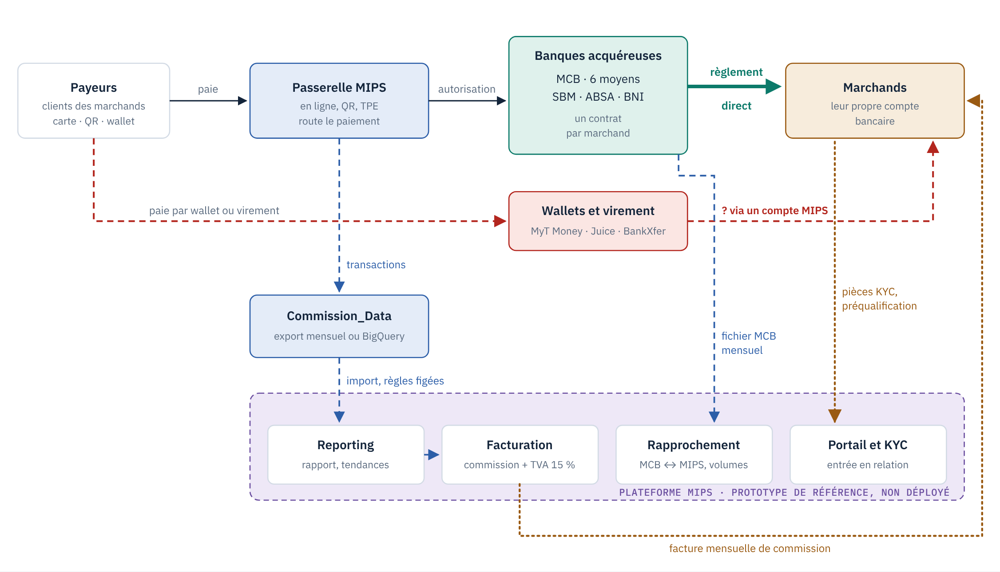

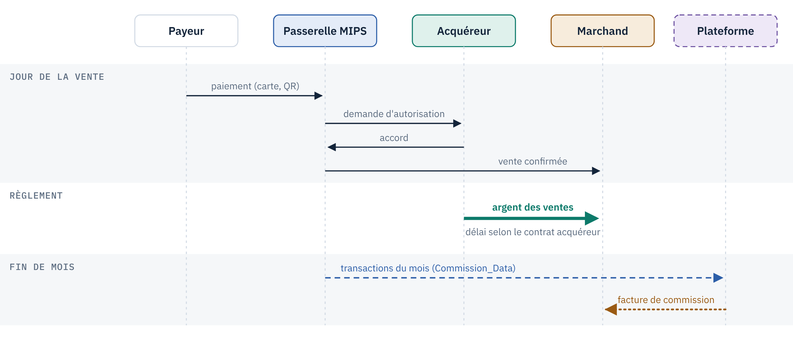

## 2.2 Dans le périmètre

| Lot | Contenu | Spécification détaillée |
|---|---|---|
| 1 — Socle | Comptes du personnel, rôles, 2FA, sessions, blocage des tentatives, journal d'audit, chiffrement, emails | ce document, § 5 et § 7 |
| 2 — Reporting et facturation | Import des transactions (fichier et BigQuery), rapport mensuel, export Excel, tendance 12 mois, règles de commission, factures | `my-mips-monthly-report-excel-export.md`, `my-mips-bigquery-commission-data.md` |
| 3 — Marchands et KYC | Fiche marchand, dossier d'entrée en relation, pièces, personnes, blocages d'approbation, double regard, relances, revues périodiques | `my-mips-onboarding-kyc.md` |
| 4 — Portail marchand | Compte prospect, 2FA, conditions d'utilisation versionnées, préqualification, dépôt des pièces, antivirus, suivi | `my-mips-merchant-portal.md` |
| 5 — Rapprochement MCB | Rapprochement mensuel MCB ↔ MIPS (e-commerce), ventilation des écarts, réclamation MCB | `my-mips-mcb-reconciliation.md` |

## 2.3 Hors périmètre

| Sujet | Raison |
|---|---|
| Réconciliation du compte trust | **[HORS PÉRIMÈTRE]** Modèle A retenu. La spécification `my-mips-trust-reconciliation.md` porte la mention « NE PAS DÉVELOPPER » et ne sert qu'en cas de passage au modèle B. |
| Traitement des paiements, remboursements, règlements | La passerelle de paiement existante n'est pas touchée. my.mips.mu **lit** des données ; il n'exécute aucune opération financière. |
| Change (Forex) | L'affichage éventuel de taux n'est pas une capacité d'exécution de change. |
| Espace du marchand actif, screening AML automatisé, surveillance des transactions, remboursements / chargebacks / réclamations | Non spécifiés à ce jour. Voir § 9 : à spécifier dans des marchés séparés. |

## 2.4 Règle de présentation

Rien dans my.mips.mu ne doit présenter une fonctionnalité comme un service SPIN autorisé ou opérationnel sans
preuve. Le rapprochement MCB est un **contrôle des volumes** acquéreur ↔ plateforme ; il n'est jamais présenté
comme une protection des fonds ni comme une réconciliation du trust.

# 3. Documents de référence

| Document | Emplacement |
|---|---|
| Décision sur le modèle de flux de fonds | `outputs/decisions/2026-10-31-modele-flux-de-fonds.md` |
| Six spécifications détaillées | `outputs/dev-handover/` |
| Modèle de données de référence | `sql/schema.sql` |
| Paramètres de référence | `config/config.php` (sans les secrets, qui sont des valeurs factices) |
| Tests de recette de référence (11 suites, 590 vérifications) | `tests/`, lancés par `tests/run_tests.sh` |
| Jeux de données fictifs et résultats attendus | `tests/fixtures/` |
| Schémas d'architecture et d'écosystème | `outputs/ecosysteme/` |
| Captures du prototype (marquées DEV) | `outputs/screens/`, `outputs/bom-screenshots/` |
| Preuves manquantes pour le dossier BoM | `outputs/bom-screenshots/missing-evidence.md` |

# 4. Utilisateurs et rôles

| Population | Rôle | Accès | 2FA |
|---|---|---|---|
| Personnel MIPS | `admin` | Tous les modules, gestion des utilisateurs, journal d'audit, publication des conditions | **Obligatoire** [FIGÉ] |
| Personnel MIPS | `finance` | Reporting, facturation, marchands, onboarding, rapprochement | **Obligatoire** [FIGÉ] |
| Personnel MIPS | `user` | Aucun module sensible par défaut | Facultative |
| Prospects et marchands | compte portail | Son propre dossier uniquement | **Obligatoire** [FIGÉ] |
| Tâches planifiées | système | Relances KYC, imports | sans objet |

Exigences :

- **R-ROLE-1** [FIGÉ] L'accès à chaque module est défini en configuration (rubrique `access`), jamais dans le code.
- **R-ROLE-2** [FIGÉ] Les comptes marchands sont dans une table distincte ; un compte marchand ne peut jamais obtenir un rôle du personnel.
- **R-ROLE-3** [FIGÉ] Un changement de rôle s'applique dès la requête suivante, y compris pour une session ouverte.
- **R-ROLE-4** [À CONFIRMER — CEO, conformité] Rôles supplémentaires probables en production (conformité / analyste KYC, approbateur, lecture seule). Le prototype n'en a que trois ; le modèle doit permettre d'en ajouter sans modifier le code.
- **R-ROLE-5** [FIGÉ] Il faut au moins un approbateur qui n'est jamais intervenu sur un dossier pour pouvoir le trancher. L'organisation doit prévoir assez de personnes habilitées.

# 5. Architecture et exigences techniques

## 5.1 Architecture cible

Deux interfaces, un socle commun (figure 3).

- **Back-office** pour le personnel, session du personnel.
- **Portail marchand** sur un **sous-domaine dédié** [PROPOSITION], session séparée (cookie distinct).
- **Commandes planifiées** (relances KYC, imports).
- **Contrôles centralisés appliqués à toute requête** : en-têtes de sécurité, session liée au navigateur, jeton anti-falsification sur toute modification, rôle et 2FA (personnel), 2FA, conditions acceptées et accès à son seul dossier (marchand).
- **Socle commun** : authentification, 2FA, blocage des tentatives, journal en ajout seul, chiffrement, stockage des documents, emails.
- **Stockage** : une base relationnelle unique ; documents **hors de la racine web**.
- **Services externes** : BigQuery (lecture seule), antivirus ClamAV (démon `clamd`), SMTP, fichier MCB mensuel.

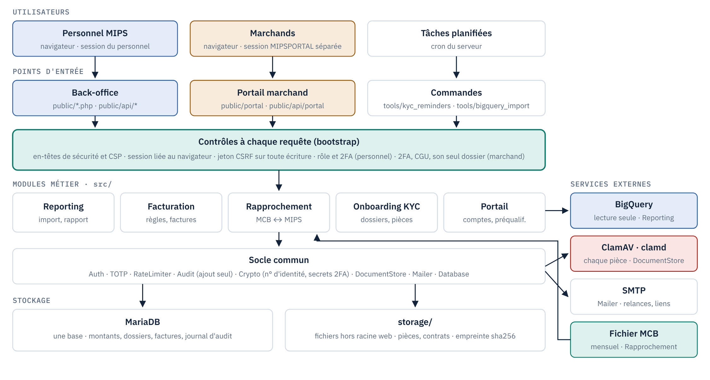

## 5.2 Choix techniques

- **R-TECH-1** La stack est au choix de MIPS et du prestataire. Le prototype (PHP 8.3, MariaDB 10.11, sans framework) n'impose rien. Ce qui doit être conservé : les principes du § 5.1 et les règles du § 7.
- **R-TECH-2** [FIGÉ] Montants stockés en **entiers (centimes)**, jamais en flottants ; une devise par calcul, aucune conversion implicite.
- **R-TECH-3** [FIGÉ] Fuseau horaire de référence : `Indian/Mauritius`. Toute date importée est convertie explicitement (piège documenté dans la spec BigQuery, § 4).
- **R-TECH-4** [FIGÉ] Seuils, listes de pièces, rôles, délais, correspondances de colonnes : en configuration, validés par leur propriétaire métier.
- **R-TECH-5** [FIGÉ] Secrets (base, SMTP, clé de chiffrement, accès BigQuery) **hors du code et hors du dépôt**.
- **R-TECH-6** [PROPOSITION] Migrations de schéma versionnées et rejouables ; aucune modification manuelle de la base de production.

## 5.3 Environnements

- **R-ENV-1** [PROPOSITION] Trois environnements : développement, recette, production. Les deux premiers n'utilisent **que des données fictives ou anonymisées**.
- **R-ENV-2** Tout écran hors production porte un bandeau visible indiquant l'environnement (le prototype affiche « DEMO »).
- **R-ENV-3** Les emails hors production partent vers un collecteur de test, jamais vers des destinataires réels.

# 6. Exigences fonctionnelles par lot

Chaque lot reprend sa spécification détaillée. Ce chapitre en résume les règles structurantes et les critères
d'acceptation ; il ne les remplace pas.

## 6.1 Lot 1 — Socle

| Réf. | Exigence |
|---|---|
| R-AUTH-1 | [FIGÉ] Connexion par email et mot de passe, puis second facteur TOTP si activé ou exigé par le rôle. Codes de secours à usage unique. |
| R-AUTH-2 | [FIGÉ] Un rôle à 2FA obligatoire sans 2FA activée : mot de passe accepté, puis **tous les modules fermés** et renvoi vers l'enrôlement. Le titulaire ne peut pas désactiver une 2FA exigée. |
| R-AUTH-3 | [FIGÉ] Blocage : **5 échecs par compte** sur 15 minutes, toutes adresses confondues ; **50 échecs par adresse IP**, tous comptes confondus (réglable). Une connexion réussie remet à zéro **ce compte seulement**. Mot de passe oublié et inscription ont leurs propres quotas et ne comptent pas comme des échecs. |
| R-AUTH-4 | [FIGÉ] Changement de mot de passe, de rôle ou de 2FA : toutes les autres sessions du compte sont fermées. [PROPOSITION] Implémenter par un **compteur de version de session**, plus simple et plus sûr que la comparaison d'horodatages (voir § 12, piège 2). |
| R-AUTH-5 | [FIGÉ] Session expirée après 30 minutes d'inactivité ; cookie `Secure`, `HttpOnly`, `SameSite`. |
| R-AUTH-6 | [PROPOSITION] Mot de passe d'au moins **12 caractères** et refus des mots de passe connus comme compromis. Le prototype n'exige que 8 caractères : c'est insuffisant pour un système qui donne accès à des données KYC. |
| R-AUTH-7 | [FIGÉ] Réinitialisation du mot de passe par lien à usage unique valable 60 minutes ; réponse identique que le compte existe ou non. |
| R-ADM-1 | [FIGÉ] L'administrateur crée, modifie, désactive les comptes et réinitialise une 2FA (téléphone perdu). La réinitialisation ferme l'accès aux modules jusqu'au réenrôlement. |
| R-AUD-1 | [FIGÉ] **Toute action** est inscrite au journal d'audit : acteur, date, objet, avant/après. Journal **en ajout seul** : une correction est une nouvelle écriture. |
| R-AUD-2 | [PROPOSITION] Inaltérabilité garantie par les droits de la base (le compte applicatif n'a ni `UPDATE` ni `DELETE` sur le journal) et, idéalement, par chaînage d'empreintes ou export régulier vers un stockage non modifiable. Le prototype ne repose que sur les droits. |
| R-CRY-1 | [FIGÉ] Numéros d'identité et secrets 2FA **chiffrés** en base ; jamais dans les logs ni dans le journal d'audit. |

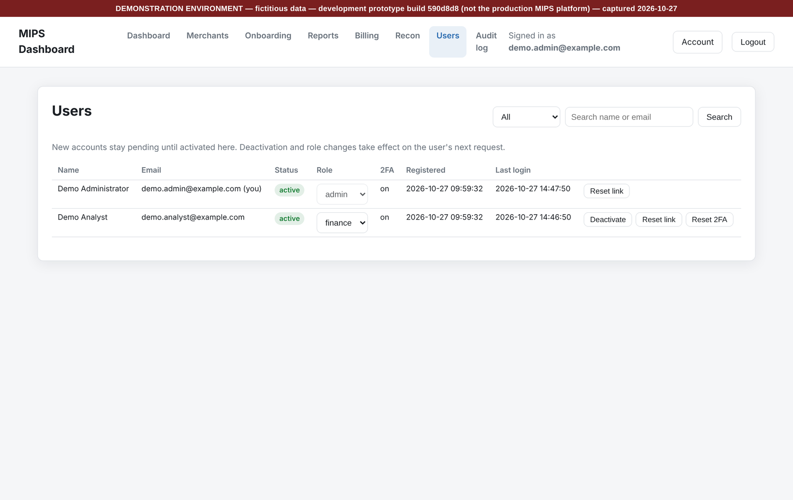

## 6.2 Lot 2 — Reporting et facturation

Spécifications : `my-mips-monthly-report-excel-export.md`, `my-mips-bigquery-commission-data.md`.

| Réf. | Exigence |
|---|---|
| R-REP-1 | [FIGÉ] Import mensuel des transactions par fichier (Commission_Data) puis, à terme, lecture directe dans BigQuery en **lecture seule**. Les deux voies appliquent les mêmes règles de nettoyage. |
| R-REP-2 | [FIGÉ] Règles de nettoyage : statut `SUCCESS` seul ; transactions de test exclues ; remboursements **comptés, jamais déduits** ; TPE identifiés par `is_for_till_id` ; rails CARD / QR / PUSH / OTHER ; volumes en MUR seulement. |
| R-REP-3 | [FIGÉ] Empreinte sha256 de chaque fichier importé ; un mois déjà facturé ne se réimporte pas. |
| R-REP-4 | [FIGÉ] Alertes « Verify before use » toujours affichées, jamais filtrées. |
| R-REP-5 | [FIGÉ] Export Excel conforme à la spec (onglets, ordre des lignes, mise en forme). Tendance 12 mois. |
| R-REP-6 | [FIGÉ] Le rapport reproduit **exactement** le script d'analyse actuel sur les mêmes fichiers ; c'est le premier critère d'acceptation. |
| R-BIL-1 | [FIGÉ] Règles de commission : la règle la plus spécifique gagne. |
| R-BIL-2 | [FIGÉ] Cycle de facture : brouillon → émise → payée ou annulée. Le numéro est attribué à l'émission. Une facture émise ne se modifie pas. |
| R-BIL-3 | [À CONFIRMER — finance] Unité de `somme_totale` (MUR ou centimes), traitement des remboursements dans l'assiette, TVA sur les commissions, mentions de l'émetteur. |
| R-BIL-4 | [PROPOSITION] Séparation préparateur / approbateur sur l'émission des factures. Absente du prototype. |

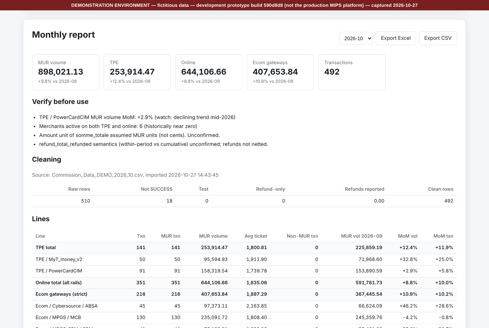

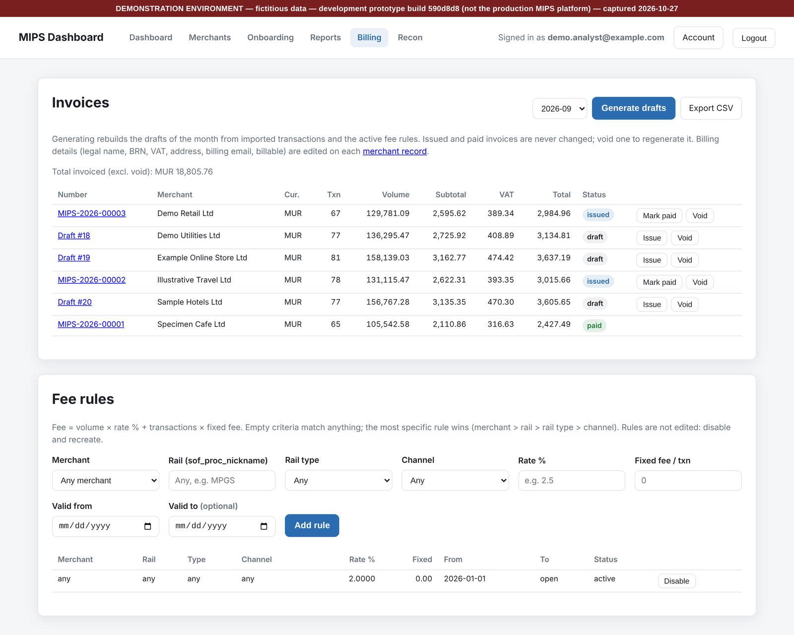

## 6.3 Lot 3 — Marchands et KYC

Spécification : `my-mips-onboarding-kyc.md`.

| Réf. | Exigence |
|---|---|
| R-MER-1 | [FIGÉ] Fiche marchand : identité, statut (prospect, actif…), facturable, MID associés. |
| R-KYC-1 | [FIGÉ] Un dossier d'entrée en relation par marchand, avec statuts et transitions définis ; `approved` et `rejected` sont définitifs. Une revue périodique ouvre un nouveau dossier. |
| R-KYC-2 | [À CONFIRMER — conformité] Liste des pièces configurable (11 pièces par défaut, au niveau du dossier ou de chaque personne), seuil de bénéficiaire effectif 25 %, durées de revue 1 / 2 / 3 ans selon le risque, règle « PEP ⇒ risque élevé », durées de conservation. |
| R-KYC-3 | [FIGÉ] Blocages d'approbation calculés et affichés en permanence : toutes les pièces requises acceptées, au moins un administrateur et un bénéficiaire effectif, actionnaires au-dessus du seuil enregistrés comme bénéficiaires, chaque personne contrôlée sans résultat positif, note de risque, raison sociale et BRN. |
| R-KYC-4 | [FIGÉ] **Double regard** : une pièce n'est pas acceptée par la personne qui l'a déposée ; un dossier n'est approuvé ou rejeté que par une personne **qui n'est jamais intervenue** sur lui : ni son créateur, ni aucun analyste qui en a été chargé, ni quiconque l'a réassigné. Les intervenants sont enregistrés au fil de l'eau. |
| R-KYC-5 | [FIGÉ] Contrôle sanctions / PEP **saisi** par personne (résultat et référence). Toute modification d'identité remet le contrôle à faire. Le screening automatisé est hors périmètre (§ 9). |
| R-KYC-6 | [FIGÉ] Relances automatiques des pièces manquantes, alertes d'expiration des pièces d'identité, revues périodiques. |
| R-KYC-7 | [FIGÉ] Un dossier déclaré complet par le marchand n'est **jamais** présenté au marchand comme approuvé. |

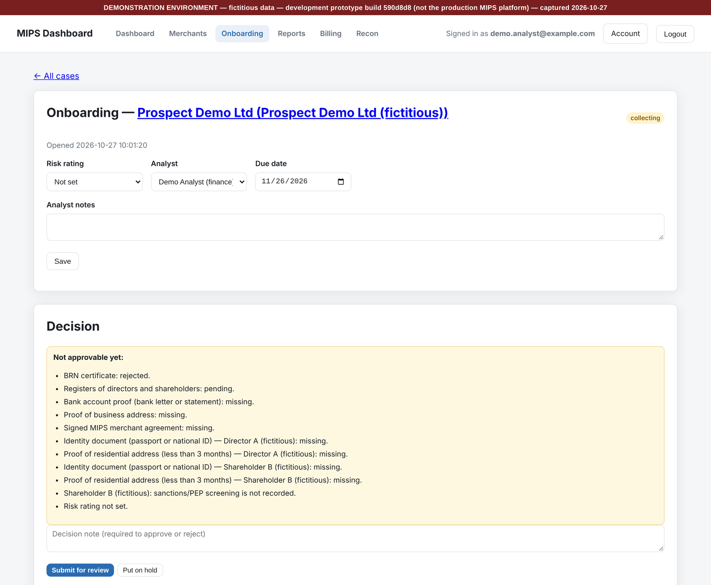

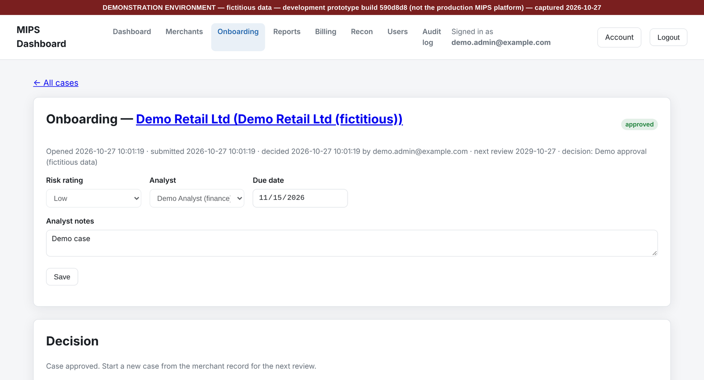

## 6.4 Lot 4 — Portail marchand

Spécification : `my-mips-merchant-portal.md`.

| Réf. | Exigence |
|---|---|
| R-POR-1 | [FIGÉ] Compte prospect avec email vérifié, **2FA obligatoire**, puis acceptation de la **version en vigueur** des conditions d'utilisation, avant tout accès. |
| R-POR-2 | [FIGÉ] Conditions versionnées, publiées par un administrateur ; chaque acceptation est tracée (compte, version, date). Une nouvelle version exige une nouvelle acceptation. |
| R-POR-3 | [À CONFIRMER — juridique] **Texte réel** des conditions. Le prototype contient un texte de remplissage. |
| R-POR-4 | [FIGÉ] Préqualification : une seule par compte, non modifiable après envoi. Son acceptation par MIPS ouvre le dossier KYC. Signaux pour l'analyste seulement, aucune notation automatique. |
| R-POR-5 | [À CONFIRMER — conformité] Secteurs sensibles, tranche de volume signalée, règles d'éligibilité. |
| R-POR-6 | [FIGÉ] Le marchand dépose ses pièces et déclare ses personnes (administrateurs, bénéficiaires, signataires). Il peut déclarer une personne PEP mais **ne peut pas retirer** ce statut. |
| R-POR-7 | [FIGÉ] Le dossier ciblé n'est **jamais pris dans la requête** : c'est toujours celui du compte connecté. Tout identifiant reçu est vérifié comme appartenant à ce dossier. |
| R-POR-8 | [FIGÉ] Le marchand ne voit jamais : note de risque, résultat du filtrage, blocages internes, notes internes, signaux de préqualification, noms des employés MIPS. |
| R-POR-9 | [FIGÉ] Toute action du marchand est tracée (acteur `portal:<email>`) et visible dans l'historique du dossier côté MIPS. |
| R-POR-10 | [FIGÉ] Codes de refus précis, chacun couvert par un test : 419 jeton anti-falsification, 403 renvoi vers 2FA ou conditions, 409 dossier fermé, 429 trop de dépôts, 422 format refusé ou fichier infecté, 503 antivirus indisponible. **Les cas 419 et 429 ne sont pas encore testés dans le prototype** : à couvrir dans my.mips.mu. |

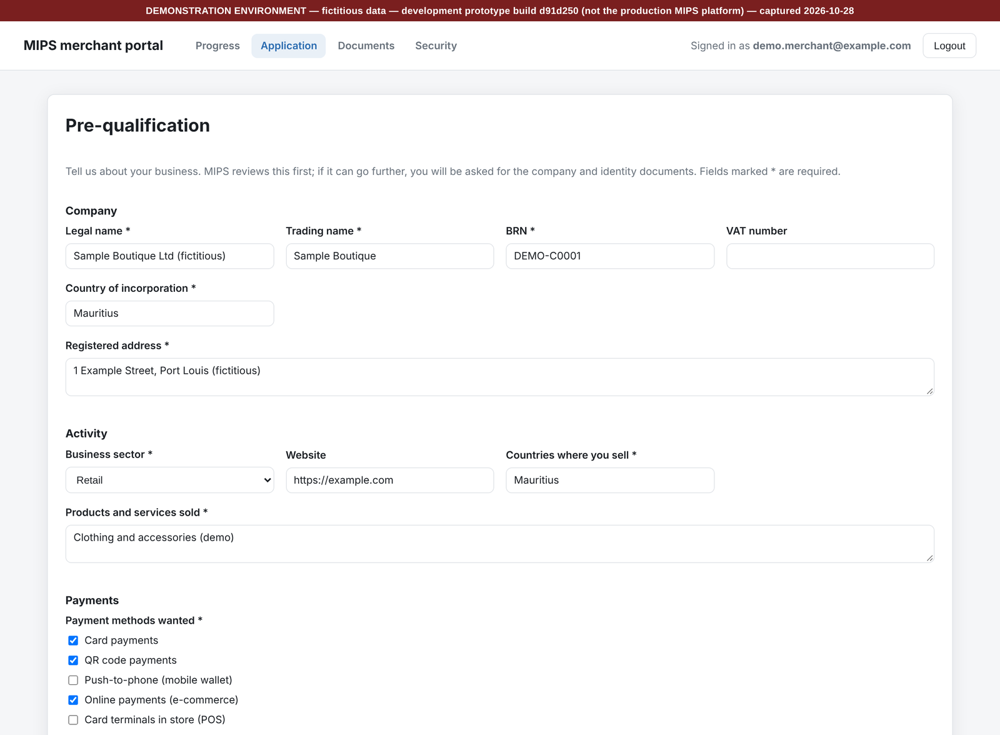

## 6.5 Antivirus des pièces (lots 3 et 4)

| Réf. | Exigence |
|---|---|
| R-AV-1 | [FIGÉ] **Toute** pièce déposée, par le personnel ou le marchand, est analysée avant d'être stockée. |
| R-AV-2 | [FIGÉ] Démon `clamd` appelé par `clamdscan --fdpass --no-summary`. Mesuré : moins de 0,1 s par fichier, contre environ 20 s avec `clamscan` qui recharge la base à chaque appel. |
| R-AV-3 | [FIGÉ] **Refus en cas de doute** : sain → stocké ; infecté → refusé (422) ; erreur, démon arrêté, base absente → refusé (503). Jamais de dépôt accepté sans analyse. |
| R-AV-4 | [FIGÉ] Contrôle de format avant l'antivirus ; taille maximale 20 Mo ; empreinte sha256 enregistrée. |
| R-AV-5 | [PROPOSITION] `freshclam` supervisé : alerte si les signatures ont plus de 48 heures. Sans signatures, tous les dépôts sont refusés. |
| R-AV-6 | [PROPOSITION] Procédure écrite en cas de détection : qui est prévenu, que dit-on au marchand, que fait-on du dossier. |

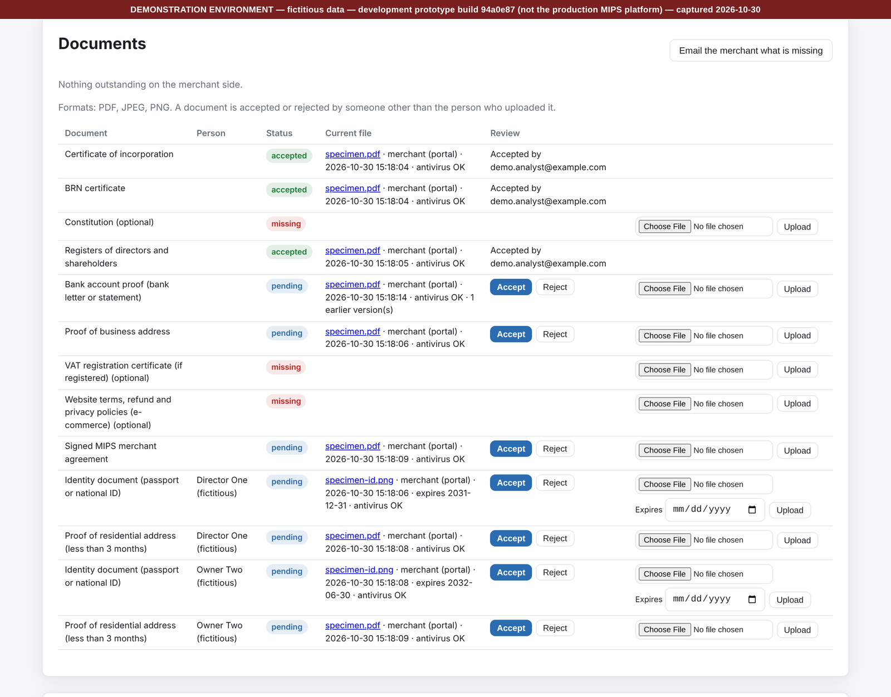

## 6.6 Lot 5 — Rapprochement MCB

Spécification : `my-mips-mcb-reconciliation.md`.

| Réf. | Exigence |
|---|---|
| R-REC-1 | [FIGÉ] Contrôles de périmètre **bloquants** avant tout calcul : extraction MIPS complète (non filtrée), fenêtres de dates, hors périmètre e-commerce. |
| R-REC-2 | [FIGÉ] Correspondances de MID (un marchand, deux MID), agrégation par marchand et devise, montants en centimes. |
| R-REC-3 | [FIGÉ] Chaque écart ventilé en six catégories dans un ordre imposé ; **invariant de bouclage** vérifié par le code (la somme des catégories égale l'écart total). |
| R-REC-4 | [FIGÉ] Pourcentage d'écart par devise ; liste des vrais écarts et préparation de la réclamation MCB. |
| R-REC-5 | [À CONFIRMER — finance] Validation sur **un mois déjà réconcilié à la main** avant mise en service. |
| R-REC-6 | [PROPOSITION] Séparation préparateur / approbateur sur la clôture d'un rapprochement. Absente du prototype. |

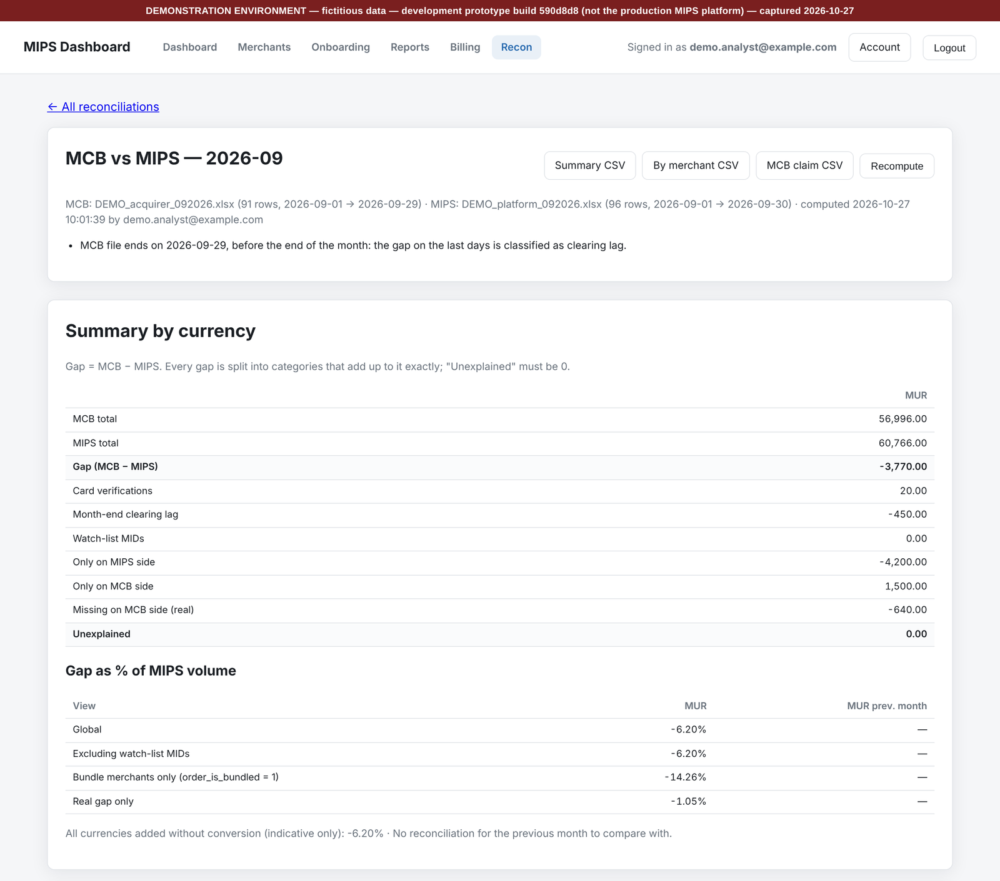

# 7. Exigences non fonctionnelles

## 7.1 Sécurité applicative

| Réf. | Exigence |
|---|---|
| R-SEC-1 | [FIGÉ] **Le serveur décide** : aucun contrôle ne vit seulement dans le navigateur. |
| R-SEC-2 | [FIGÉ] Politique de sécurité du contenu stricte, sans script en ligne ; en-têtes de sécurité sur toutes les réponses. |
| R-SEC-3 | [FIGÉ] Jeton anti-falsification sur toute requête qui modifie quelque chose. |
| R-SEC-4 | [FIGÉ] Session liée au navigateur ; sessions personnel et marchand séparées et testées dans les deux sens. |
| R-SEC-5 | [FIGÉ] Requêtes paramétrées uniquement ; validation de chaque entrée côté serveur. |
| R-SEC-6 | [FIGÉ] Documents hors de la racine web, servis uniquement après contrôle d'accès. |
| R-SEC-7 | [PROPOSITION] HTTPS uniquement, HSTS, certificats gérés et renouvelés automatiquement. |
| R-SEC-8 | [PROPOSITION] Test d'intrusion par un tiers avant la mise en service du portail marchand, qui est exposé sur Internet. |
| R-SEC-9 | [PROPOSITION] Revue de sécurité par un pair pour chaque lot : accès, double regard, données sensibles, fichiers. |

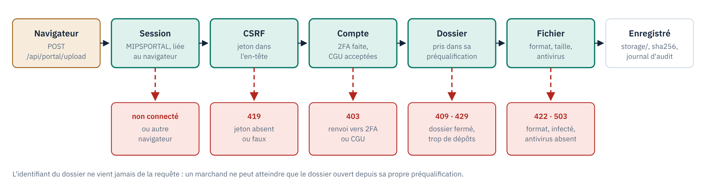

## 7.2 Données personnelles

- **R-DP-1** [À CONFIRMER — conformité] Conformité au **Data Protection Act 2017** (Maurice) : finalités, base légale, information des personnes, durées de conservation, droits d'accès. Je n'ai pas vérifié les obligations précises : à faire valider.
- **R-DP-2** [FIGÉ] Minimisation : le marchand ne voit que ses propres données ; les logs ne contiennent ni numéro d'identité, ni secret, ni contenu de pièce.
- **R-DP-3** [PROPOSITION] Purge ou anonymisation automatique à l'échéance des durées de conservation, tracée au journal.
- **R-DP-4** [FIGÉ] Aucune donnée réelle dans les environnements de développement et de recette, ni dans le dépôt de code.

## 7.3 Exploitation

Les valeurs ci-dessous sont des **propositions** à arbitrer : je n'ai aucune donnée sur l'hébergement actuel de MIPS.

| Réf. | Exigence |
|---|---|
| R-OPS-1 | [PROPOSITION] Disponibilité : back-office aux heures ouvrées de Maurice ; portail marchand 99,5 % par mois. |
| R-OPS-2 | [PROPOSITION] Sauvegarde quotidienne chiffrée de la base **et** des documents, conservée hors du serveur ; **test de restauration** au moins une fois par trimestre. Objectifs : perte maximale 24 h, remise en service sous 1 jour ouvré. |
| R-OPS-3 | [PROPOSITION] Supervision : disponibilité, erreurs serveur, file d'emails, état de `clamd` et âge des signatures, échec des tâches planifiées. |
| R-OPS-4 | [PROPOSITION] Journaux techniques conservés 12 mois, sans donnée personnelle sensible. |
| R-OPS-5 | [À CONFIRMER — responsable technique] Hébergement, localisation des données, SMTP de production, accès BigQuery de production. |

## 7.4 Performance

- **R-PERF-1** [PROPOSITION] Pages du back-office et du portail affichées en moins de 2 secondes pour 95 % des requêtes.
- **R-PERF-2** [PROPOSITION] Import d'un mois de transactions et calcul du rapport en moins de 5 minutes.
- **R-PERF-3** [FIGÉ] Analyse antivirus d'une pièce en moins d'une seconde (avec `clamd`).

# 8. Recette

## 8.1 Principe

Le prototype fournit **11 suites de tests automatiques, 590 vérifications**, sur une base jetable avec SMTP et
BigQuery simulés. Quatorze erreurs volontairement introduites dans le code ont toutes été détectées. Ces suites
**sont la base de la recette** : chaque lot reprend les scénarios et les montants attendus de ses suites. Les
appels HTTP changeront avec la stack ; les scénarios, les jeux de données fictifs et les résultats attendus ne
changent pas.

| Suite | Vérifications | Lot |
|---|---|---|
| `admin_test.py` (comptes, 2FA, audit, blocage) | 93 | 1 |
| `staff_2fa_required_test.py` | 23 | 1 |
| `reporting_test.py` | 65 | 2 |
| `bigquery_test.py` | 23 | 2 |
| `billing_test.py` | 47 | 2 |
| `merchants_test.py` | 71 | 3 |
| `staff_onboarding_test.py` | 11 | 3 |
| `onboarding_approval_test.py` (approbation, double regard) | 78 | 3 |
| `portal_test.py` | 113 | 4 |
| `antivirus_clamav_test.py` | 11 | 3 et 4 |
| `recon_test.py` | 55 | 5 |

Les tests prouvent que le code applique les règles ; ils ne prouvent pas que les règles sont les bonnes. Les
points [À CONFIRMER] restent à valider par leurs propriétaires.

## 8.2 Définition de « terminé » pour un lot

1. **Tests de recette** : les tests de la spécification et les scénarios des suites de référence passent, automatisés, dans l'intégration continue.
2. **Données réelles** : résultat comparé au processus actuel sur **au moins un mois** (rapport, factures, rapprochement).
3. **Revue de sécurité** : accès, double regard, données sensibles, fichiers vérifiés par un pair.
4. **Configuration validée** : seuils et listes signés par la conformité ou la finance.
5. **Traçabilité** : chaque action du lot apparaît dans le journal d'audit.
6. **Documentation** : spécification à jour, paramètres décrits, procédure d'exploitation.

## 8.3 Tests supplémentaires exigés

- **R-TEST-1** Un test par code de refus (§ 6.4, R-POR-10), dont 419 et 429 sur le portail.
- **R-TEST-2** Pour chaque contrôle à quatre yeux : tester le **contournement**, pas seulement le cas nominal (créer, réassigner, puis décider).
- **R-TEST-3** Antivirus : cas sain, infecté, démon arrêté, base absente, binaire absent.

# 9. Fonctions à spécifier séparément

Ces fonctions sont attendues pour un dossier réglementaire complet mais **ne sont pas spécifiées**. Elles ne font
pas partie de ce marché. Chacune fera l'objet d'une spécification séparée, puis d'un chiffrage.

| Fonction | Ce qui manque aujourd'hui | Propriétaire de la spec |
|---|---|---|
| Espace du marchand actif | Transactions, relevés, règlements (en lecture, selon l'acquéreur), utilisateurs du marchand | CEO, produit |
| Screening AML automatisé | Fournisseur sanctions / PEP / adverse media, re-screening périodique, traitement des résultats positifs | Conformité |
| Surveillance des transactions | Règles et seuils, file d'alertes, investigation, déclaration de soupçon. Les alertes de volume du reporting **ne sont pas** un dispositif AML. | Conformité |
| Remboursements, chargebacks, réclamations | Registres, statuts, délais, escalade | Opérations, conformité |

# 10. Livrables attendus

1. Code source dans un dépôt MIPS, avec historique.
2. Schéma de base et migrations.
3. Tests automatisés reprenant la recette (§ 8), lancés par l'intégration continue.
4. Fichier de configuration documenté, sans secrets.
5. Procédure d'installation, de mise à jour, de sauvegarde et de restauration.
6. Procédure d'exploitation : supervision, antivirus, rotation des secrets, incident.
7. Spécifications mises à jour à la fin de chaque lot.

# 11. Découpage et prérequis

## 11.1 Paliers

| Palier | Contenu | Peut démarrer |
|---|---|---|
| 0 — Décisions | Vérifications du modèle A, seuils KYC, texte des conditions | maintenant |
| 1 — Socle | Lot 1 | maintenant |
| 2 — Reporting et facturation | Lot 2 | après le palier 1 |
| 3 — Marchands et KYC | Lot 3, antivirus | après le palier 1 |
| 4 — Portail marchand | Lot 4 | après le palier 3 |
| 5 — Rapprochement MCB | Lot 5 | après le palier 2 |
| 6 — Trust | **Hors plan**, seulement si le modèle B est un jour retenu | — |

Chaque palier se termine quand sa définition de « terminé » (§ 8.2) est remplie. **Pas de dates tant que le palier
0 n'est pas tranché.** Les paliers 1 à 5 peuvent démarrer sans attendre toutes ses réponses, mais aucune valeur
[À CONFIRMER] ne part en production sans validation écrite.

## 11.2 Décisions et informations attendues

| Sujet | Propriétaire | Bloque |
|---|---|---|
| Licence compatible avec le modèle A (pas d'obligation de détenir les fonds) | Conformité | Tout le dossier ; la décision de modèle |
| Aucun flux wallets ou virement par un compte MIPS | Finance | La décision de modèle |
| Liste des pièces, seuils KYC, formulation PEP, durées de conservation | Conformité | Mise en service du lot 3 |
| Texte des conditions d'utilisation | Juridique | Mise en service du lot 4 |
| Unité des montants, remboursements, TVA, mentions de facture | Finance | Mise en service du lot 2 |
| Hébergement, SMTP, sauvegardes, HTTPS, accès BigQuery de production | Responsable technique | Mise en service de tous les lots |
| Un mois MCB déjà réconcilié à la main | Finance | Recette du lot 5 |
| Rôles supplémentaires et personnes habilitées à approuver | CEO, conformité | Mise en service du lot 3 |

# 12. Pièges connus, à ne pas reproduire

Trouvés par les tests du prototype, corrigés dans la référence.

1. **Blocage des connexions par adresse IP.** Cinq échecs depuis une adresse bloquaient tous les comptes derrière elle, donc tout un bureau ; une connexion réussie effaçait les compteurs de l'adresse, ce qui permettait d'attaquer les autres comptes sans limite. Règle correcte : R-AUTH-3.
2. **Sessions après changement de mot de passe.** Comparer des horodatages stockés à la seconde laissait survivre une session ouverte entre deux changements dans la même seconde. Corrigé à la microseconde dans la référence ; un compteur de version est recommandé (R-AUTH-4).
3. **Double regard contourné par réassignation.** Le contrôle ne comparait que l'analyste du moment : un analyste pouvait réassigner le dossier puis le trancher lui-même. Règle correcte : R-KYC-4. Leçon générale : un double regard se vérifie sur **tout l'historique** des intervenants, et se teste par son contournement.

# 13. Glossaire

| Terme | Définition |
|---|---|
| Acquéreur | Banque qui accepte les paiements par carte pour le marchand et le règle (MCB, SBM, ABSA). |
| BRN | Business Registration Number, numéro d'immatriculation d'une entreprise à Maurice. |
| Commission_Data | Export des transactions de la passerelle MIPS, base du reporting et de la facturation. |
| Double regard | Contrôle à quatre yeux : la personne qui décide n'est pas celle qui a préparé. |
| KYC / KYB | Know Your Customer / Know Your Business : vérification de l'identité du marchand et de ses personnes. |
| MID | Merchant ID, identifiant du marchand chez l'acquéreur. |
| PEP | Personne politiquement exposée. |
| Modèle A | Passerelle : MIPS ne détient pas les fonds des marchands. Retenu le 31 octobre 2026. |
| Modèle B | Encaissement pour compte des marchands, avec compte trust. Non retenu. |
| TOTP | Code à usage unique généré par une application d'authentification (2FA). |
