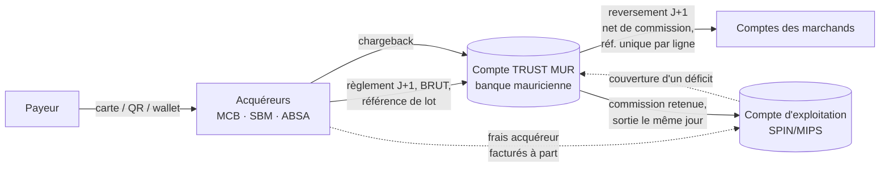

# my.mips.mu — Réconciliation du compte trust (fonds des marchands)

**Pour :** le développeur de my.mips.mu
**De :** Florent Masson (MIPS)
**Implémentation de référence :** **aucune.** Ce module n'existe ni dans le prototype `mips-platform` ni, à ma connaissance,
dans my.mips.mu. Ce document est une spécification de départ, à confirmer avant tout développement.
**Modules liés (prototype, PR #10) :** rapprochement MCB vs MIPS (`src/Recon/Reconciler.php`, spec `my-mips-mcb-reconciliation.md`),
import des transactions (`Commission_Data`, BigQuery), facturation des commissions (`src/Billing/`), journal d'audit.

> **Le rapprochement MCB vs MIPS existant n'est PAS une réconciliation du trust.** Il compare des **volumes déclarés**
> par un acquéreur aux transactions de la plateforme. Il ne regarde ni le solde d'un compte bancaire, ni ce que MIPS
> doit à chaque marchand. Ne jamais le présenter comme une preuve de protection des fonds des marchands.

> **[MODÈLE À CHOISIR] — bloquant.** D'après les éléments disponibles (§ 2.1), MIPS fonctionne aujourd'hui en
> **passerelle** : les acquéreurs paient les marchands directement et MIPS ne détient pas leurs fonds. Ce module ne sert
> que si SPIN DIGITAL **encaisse pour compte** (modèle B, § 2.2). Choisir le modèle avant de coder.

> **[CONFORMITÉ] — bloquant.** Les obligations de cantonnement (*safeguarding*) applicables à MIPS / SPIN DIGITAL
> (texte de la Banque de Maurice, conditions de licence, fréquence de rapprochement, délai de couverture d'un déficit,
> rapports au régulateur) **n'ont pas été vérifiées**. Les règles marquées [CONFORMITÉ] sont des hypothèses prudentes,
> à remplacer par les exigences écrites. Toutes les valeurs (heures de clôture, seuils, délais) sont en configuration.

---

## 1. Objectif et définitions

Démontrer **chaque jour ouvré**, pièces à l'appui, que **l'argent détenu pour le compte des marchands est intégralement
présent sur le(s) compte(s) trust**, et détecter immédiatement tout déficit ou tout mélange avec les fonds propres de MIPS.

| Terme | Définition dans ce document |
|---|---|
| **Compte trust** | Compte bancaire cantonné, ouvert au nom de MIPS pour le compte des marchands, qui ne doit contenir que des fonds des marchands |
| **Droits des marchands** (*merchant entitlements*) | Ce que MIPS doit aux marchands à une date donnée : encaissements reçus pour eux, moins commissions MIPS acquises, moins reversements effectués, moins remboursements et chargebacks |
| **Grand livre trust** | Comptabilité en partie double, tenue par le module, de tous les mouvements qui concernent le trust et les droits des marchands |
| **Déficit** (*shortfall*) | Solde bancaire du trust **inférieur** aux droits des marchands |
| **Excédent** (*excess*) | Solde bancaire **supérieur** aux droits des marchands : fonds propres de MIPS restés sur le trust (commissions non prélevées, apport), à justifier et à sortir |
| **Écart de rapprochement** (*break*) | Ligne bancaire sans écriture correspondante, ou écriture attendue sans ligne bancaire |

Tous les montants en **centimes entiers** (jamais de flottants). Fuseau horaire : **Indian/Mauritius**.

---

## 2. Flux de fonds : constat et schéma proposé

### 2.1 Constat (vérifié le 2026-10-30)

**Aujourd'hui, MIPS ne détient vraisemblablement pas les fonds des marchands.** Quatre indices concordants :

| Indice | Source |
|---|---|
| MIPS se présente comme passerelle : règlement « dans n'importe quelle banque à Maurice », **« pas de compte intermédiaire »**, l'argent va **directement** sur le compte du marchand | Fiche de l'application MIPS sur l'App Store Shopify (déclaration commerciale, pas une constatation du régulateur) |
| La commission MIPS est **facturée** au marchand (module facturation : factures mensuelles avec TVA), et non retenue sur un reversement | Prototype `mips-platform`, `src/Billing/` |
| Le rapprochement MCB se fait **par numéro de point de vente (Outlet) de chaque marchand** chez l'acquéreur : chaque marchand a son propre contrat acquéreur | Spec `my-mips-mcb-reconciliation.md`, colonnes `Outlet_Number` / `card_merchant_id` |
| Les transactions portent la banque de règlement par moyen de paiement (`fi_name`) : MCB (MPGS, Juice, PowerCard, MyT Money, virement), SBM (MPGS_SBM), ABSA (Cybersource), BNI (MPGS, Madagascar) | Export `Commission_Data` d'octobre 2026, 9 couples moyen de paiement / banque |

**Conséquence : dans le modèle actuel, il n'y a pas de compte trust à réconcilier.** Le module décrit ici ne s'applique
que si l'entité qui sollicite la licence (SPIN DIGITAL) **encaisse** les fonds pour le compte des marchands.
À confirmer par la direction financière : aucun moyen de paiement (notamment les portefeuilles MyT Money et Juice,
ou le virement bancaire) ne transite-t-il déjà par un compte MIPS ?

**Cadre réglementaire — non vérifié à la source.** Les textes de la Banque de Maurice (formulaire de demande de licence
de prestataire de services de paiement, National Payment Systems Act 2018) étaient **inaccessibles** le 2026-10-30
(erreur 503 sur bom.mu). Des sources secondaires indiquent : une section du formulaire de licence consacrée à la
protection des fonds des utilisateurs (séparation des fonds propres, ou assurance) ; pour la monnaie électronique,
un trust, un compte dédié, des mécanismes de rapprochement et un acte de trust ; selon un cabinet de conseil,
des comptes trust dans des banques mauriciennes, un rapprochement et une **certification annuelle par l'auditeur**.
**À lire dans le texte avant de coder.**

### 2.2 Les deux modèles possibles

| | **A — Passerelle (actuel)** | **B — Encaissement pour compte (agrégateur)** |
|---|---|---|
| Contrat acquéreur | un par marchand (MID / Outlet du marchand) | un contrat **au nom de SPIN/MIPS**, marchands en sous-marchands |
| Qui reçoit l'argent | le marchand, directement | le **compte trust** SPIN/MIPS |
| Commission MIPS | facturée chaque mois | **retenue** au reversement (facture = relevé) |
| Risque pour le marchand si MIPS fait défaut | aucun sur les fonds | fonds exposés → **cantonnement obligatoire** |
| Réconciliation trust | **sans objet** | **obligatoire chaque jour** (ce document) |
| Ce que MIPS rapproche | volumes acquéreur ↔ plateforme (existant) ; factures ↔ paiements des marchands | banque ↔ grand livre ↔ droits des marchands |

**Recommandation.** Ne pas lancer le développement de ce module tant que le modèle n'est pas choisi.
- Si le dossier SPIN reste en **modèle A**, il faut le dire explicitement au régulateur (« aucun fonds de marchand détenu »,
  schéma des flux à l'appui) au lieu de promettre une réconciliation trust qui n'aurait rien à réconcilier.
- Si SPIN vise le **modèle B**, les contrats acquéreurs doivent être renégociés (agrégation autorisée, MID au nom de SPIN)
  **avant** tout développement, et le schéma ci-dessous s'applique.

### 2.3 Schéma proposé pour le modèle B



| Choix proposé | Pourquoi |
|---|---|
| **Un compte trust par devise**, MUR d'abord, dans la banque qui reçoit le plus de règlements (MCB : 6 des 9 couples moyen de paiement / banque) | Moins de virements entre banques, rapprochement plus simple |
| Règlements acquéreurs **bruts**, frais acquéreur facturés séparément au compte d'exploitation | Le crédit bancaire égale la somme des transactions du lot : appariement exact |
| Reversement **quotidien J+1**, net de la commission MIPS | Les fonds restent peu de temps sur le trust ; la commission sort le jour même, donc pas d'excédent durable |
| Commission sortie vers le compte d'exploitation **dans le même lot** que les reversements | Le trust ne contient que des fonds des marchands à chaque clôture |
| **Réserve chargeback** par marchand selon le risque KYC, conservée sur le trust | Couvre les débits de chargeback sans toucher aux fonds des autres marchands |
| **Aucun frais bancaire** prélevé sur le trust : refacturé au compte d'exploitation par accord avec la banque | Évite les déficits mécaniques [CONFORMITÉ] |
| Devises autres que le MUR (BNI / Madagascar, USD) **hors du trust MUR** : compte séparé ou hors périmètre au départ | Pas de conversion dans le rapprochement |

Paramètres H1 à H7 résultants (à valider) :

| Hypothèse | Proposition |
|---|---|
| H1 Moyens de paiement au trust | tous ceux couverts par les nouveaux contrats d'agrégation ; les autres restent en modèle A |
| H2 Brut ou net | **brut**, J+1 |
| H3 Reversements | quotidiens, J+1, sans minimum |
| H4 Commission | retenue au reversement, sortie le même jour |
| H5 Chargebacks | débités sur le trust, imputés au marchand, réserve dédiée |
| H6 Frais / intérêts | hors trust ; affectation des intérêts : [CONFORMITÉ] |
| H7 Devises | MUR seulement au démarrage |

---

## 3. Sources de données

| Source | Contenu | Format | Fréquence |
|---|---|---|---|
| **Relevé bancaire du compte trust** | Solde d'ouverture et de clôture, chaque mouvement (date valeur, montant, libellé, référence banque) | **camt.053** de préférence, sinon MT940, sinon CSV de la banque (mapping de colonnes configurable, comme le rapprochement MCB) | quotidienne (J+1 au plus tard) |
| **Rapports de règlement des acquéreurs** | Par lot : date, montant brut, frais, montant net viré, liste ou totaux des transactions | fichier de chaque acquéreur (à collecter) | à chaque règlement |
| **Transactions de la plateforme** | Transactions réussies par marchand, remboursements | Commission_Data / BigQuery (déjà importés dans le prototype) | quotidienne |
| **Reversements aux marchands** | Instructions émises par MIPS : marchand, IBAN, montant, référence unique | généré par le module (§ 7) | à chaque reversement |
| **Commissions** | Barèmes et factures | module facturation existant | mensuelle / à chaque reversement |
| **Chargebacks** | Notifications des acquéreurs | fichiers ou saisie | au fil de l'eau |

**Règles d'import communes :** empreinte sha256 de chaque fichier, refus d'un fichier déjà importé, fichiers conservés
hors racine web, **contrôle de continuité** du relevé (solde d'ouverture du jour = solde de clôture de la veille ;
sinon import bloqué : relevé manquant).

---

## 4. Grand livre trust (partie double)

### 4.1 Comptes

| Compte | Nature |
|---|---|
| `TRUST_CASH:<banque>:<devise>` | Image comptable du compte bancaire trust |
| `MERCHANT_PENDING:<marchand>` | Droits d'un marchand sur des transactions dont l'acquéreur **n'a pas encore payé** MIPS |
| `MERCHANT_PAYABLE:<marchand>` | Droits d'un marchand sur des fonds **reçus** sur le trust (passif à couvrir) |
| `ACQUIRER_RECEIVABLE:<acquéreur>` | Règlements attendus d'un acquéreur, pas encore reçus |
| `MIPS_FEES_DUE` | Commissions MIPS acquises, encore sur le trust |
| `UNALLOCATED_RECEIPTS` | Encaissements reçus non encore attribués à un marchand (à vider) |
| `SUSPENSE` | Mouvements bancaires inexpliqués (doit tendre vers 0, vieillissement suivi) |
| `MIPS_OWN_FUNDS` | Apports ou excédents appartenant à MIPS |

### 4.2 Écritures (exemples)

| Événement | Débit | Crédit |
|---|---|---|
| Transaction réussie attribuée à un marchand (montant brut) | `ACQUIRER_RECEIVABLE` | `MERCHANT_PENDING` (net de commission) + `MIPS_FEES_DUE` (commission) |
| Règlement acquéreur reçu sur le trust | `TRUST_CASH` | `ACQUIRER_RECEIVABLE` |
| Même règlement : les droits des transactions du lot deviennent « reçus » | `MERCHANT_PENDING` | `MERCHANT_PAYABLE` |
| Frais acquéreur retenus sur le règlement (si H2 = net) | selon contrat [FLUX À CONFIRMER] | `ACQUIRER_RECEIVABLE` |
| Reversement à un marchand (débit bancaire constaté) | `MERCHANT_PAYABLE` | `TRUST_CASH` |
| Commission MIPS sortie vers le compte d'exploitation | `MIPS_FEES_DUE` | `TRUST_CASH` |
| Remboursement / chargeback | `MERCHANT_PAYABLE` (+ `MIPS_FEES_DUE` si la commission est rendue) | `TRUST_CASH` ou `ACQUIRER_RECEIVABLE` |
| Ligne bancaire inexpliquée | `TRUST_CASH` ou `SUSPENSE` | `SUSPENSE` ou `TRUST_CASH` |
| Couverture d'un déficit par MIPS | `TRUST_CASH` | `MIPS_OWN_FUNDS` |

**Règles :**
- chaque écriture est **équilibrée** (somme débits = somme crédits, par devise) — vérifié en base et en code ;
- les écritures sont **immuables** : une correction est une contre-passation datée, liée à l'écriture d'origine, avec motif ;
- chaque écriture porte sa **source** (ligne de relevé, lot acquéreur, transaction, instruction de reversement) ;
- une période **signée** (§ 6) est verrouillée : aucune écriture datée dans une période signée.

---

## 5. Rapprochement quotidien

Pour chaque compte trust et chaque jour ouvré, à la clôture configurée (ex. 23:59 heure de Maurice).

### 5.1 Niveau 1 — Banque ↔ grand livre (`TRUST_CASH`)
Appariement des lignes du relevé avec les écritures attendues :

| Type de ligne bancaire | Apparié avec | Clés de rapprochement |
|---|---|---|
| Crédit acquéreur | lot de règlement de l'acquéreur | montant net exact, émetteur, date valeur ± N jours ouvrés, référence de lot si présente |
| Débit de reversement | instruction de reversement émise | **référence unique** générée par MIPS, montant exact |
| Débit de commission | sortie de commission validée | référence, montant exact |
| Débit chargeback | notification de chargeback | référence acquéreur, montant |
| Frais / intérêts bancaires | règle dédiée [CONFORMITÉ : H6] | libellé, montant |

- **Automatique** quand les clés concordent sans ambiguïté ; **manuel** sinon, avec motif obligatoire et auteur tracé.
- Appariements **1-1, 1-n, n-1** autorisés (un virement couvrant plusieurs lots), jamais avec une différence de montant non expliquée.
- Lignes non appariées → **écarts**, classés : *en transit* (attendu, dans le délai normal), *en retard* (hors délai), *inconnu* (aucune attente), *montant différent*.

Contrôle : **solde de clôture bancaire = solde `TRUST_CASH` + écarts en transit justifiés**, au centime.

### 5.2 Niveau 2 — Cohérence interne du grand livre
Par construction de la partie double :
`TRUST_CASH` + `ACQUIRER_RECEIVABLE` = Σ `MERCHANT_PENDING` + Σ `MERCHANT_PAYABLE` + `MIPS_FEES_DUE` + `UNALLOCATED_RECEIPTS` + `SUSPENSE` + `MIPS_OWN_FUNDS`.
Le module recalcule chaque jour les deux membres depuis les écritures. Toute différence = **anomalie logicielle**
(bloquante, alerte à l'administrateur), pas un écart de rapprochement. Contrôle complémentaire : `ACQUIRER_RECEIVABLE`
par acquéreur = règlements attendus non reçus, rapprochés des rapports de règlement.

### 5.3 Niveau 3 — Test de cantonnement (le chiffre qui compte)

| Indicateur | Calcul |
|---|---|
| **Fonds dus aux marchands** | Σ des soldes `MERCHANT_PAYABLE` créditeurs, c'est-à-dire les droits sur des fonds **déjà reçus** (un marchand débiteur ne compense **pas** les autres [CONFORMITÉ]). Les droits `MERCHANT_PENDING` (argent pas encore reçu de l'acquéreur) sont affichés à part. Base de calcul exacte (fonds reçus seulement, ou dès la transaction) : [CONFORMITÉ] |
| **Fonds présents** | Solde bancaire de clôture du trust |
| **Marge** | Fonds présents − Fonds dus |

- **Marge < 0 → DÉFICIT** : alerte immédiate (email + écran) au directeur financier, au responsable conformité et au CEO ; dossier d'incident ouvert ; preuve de couverture (virement depuis les fonds propres) attendue dans le délai [CONFORMITÉ : délai à confirmer, hypothèse : même jour ouvré].
- **Marge > 0 → EXCÉDENT** : à justifier ligne par ligne (commissions non sorties, apport de couverture, suspens) ; sortie des fonds propres soumise à validation en double regard ; un excédent durable est un risque de **mélange des fonds** [CONFORMITÉ].
- `UNALLOCATED_RECEIPTS` et `SUSPENSE` affichés avec leur **ancienneté** ; au-delà de N jours [CONFORMITÉ], escalade.

---

## 6. Circuit de validation (double regard)

```
importé ─▶ préparé (analyste) ─▶ revu et signé (approbateur ≠ préparateur) ─▶ verrouillé
                    │                         │
                    └── écarts expliqués ─────┘   (signature impossible si : relevé manquant,
                                                   niveau 2 en anomalie, déficit sans dossier d'incident)
```

- **Préparateur** : importe, apparie, explique chaque écart (catégorie + commentaire + pièce jointe si besoin).
- **Approbateur** : rôle distinct, **jamais la même personne** que le préparateur du jour ; signe avec une note ; la signature fige le rapport (empreinte sha256 du rapport stockée).
- Un jour non signé à J+1 [CONFORMITÉ : délai] → alerte.
- Un jour signé ne se modifie pas : une erreur découverte est corrigée **le jour où elle est découverte**, par contre-passation, avec renvoi au jour d'origine.

---

## 7. Reversements aux marchands (contrôle à la source)

Le rapprochement ne vaut que si les sorties du trust sont maîtrisées.

- Montant reversable = solde `MERCHANT_PAYABLE` **disponible** − retenues (réserve chargeback, blocages).
- **Blocages automatiques** : marchand dont le dossier KYC n'est pas approuvé, marchand suspendu ou résilié, IBAN modifié depuis moins de N jours sans validation [CONFORMITÉ].
- Lot de reversement : **préparé** par un analyste, **approuvé** par un autre, puis fichier bancaire généré (format de la banque) avec une **référence unique par ligne** ; aucun montant supérieur au disponible ; total du lot affiché avant validation.
- Changement d'IBAN d'un marchand : double regard + justificatif (RIB/lettre de la banque) + trace.
- La sortie n'est comptabilisée comme définitive qu'au **rapprochement du débit bancaire** (niveau 1) ; avant, elle est « émise ».

---

## 8. Rapports et preuves

| Rapport | Contenu | Usage |
|---|---|---|
| **État quotidien de cantonnement** | Par compte : solde bancaire, fonds dus aux marchands, marge, détail de l'excédent, écarts par catégorie et ancienneté, préparateur, approbateur, horodatages, empreinte | Preuve interne quotidienne ; PDF + Excel |
| **Grand livre par marchand** | Mouvements et solde d'un marchand sur une période | Litiges, audit |
| **Vieillissement des écarts** | Écarts ouverts par ancienneté | Pilotage |
| **Registre des incidents** | Déficits, dates, causes, couverture, clôture | Conformité, régulateur |
| **Attestation mensuelle** | Synthèse du mois, jours signés / non signés, incidents | Direction, auditeur, régulateur [CONFORMITÉ : format attendu] |

Tous les rapports portent la mention de la source (relevés importés, empreintes) et ne sont **jamais** régénérés à l'identique après verrouillage sans mention « copie ».

---

## 9. Modèle de données (proposé)

| Table | Contenu |
|---|---|
| `trust_accounts` | banque, n° de compte (masqué à l'écran), devise, actif |
| `bank_statements` / `bank_statement_lines` | fichier (sha256), date, soldes ; lignes : date valeur, montant (centimes), sens, libellé, référence, statut d'appariement |
| `acquirer_settlements` / `acquirer_settlement_items` | acquéreur, lot, brut, frais, net, date ; transactions ou totaux |
| `ledger_entries` / `ledger_lines` | écriture (date, type, source, contre-passation de) ; lignes (compte, débit, crédit, devise) ; contrainte d'équilibre |
| `recon_matches` | lignes bancaires ↔ écritures, mode (auto/manuel), auteur, motif |
| `trust_recon_days` | compte, jour, soldes, marge, statut (importé / préparé / signé), préparateur, approbateur, empreinte du rapport |
| `trust_breaks` | écart, catégorie, ancienneté, explication, pièce, clôture |
| `trust_incidents` | déficit, montant, détection, couverture, clôture, notifications |
| `payout_batches` / `payout_items` | lot, préparateur, approbateur, statut, lignes (marchand, IBAN masqué, montant, référence unique) |
| `merchant_bank_accounts` | IBAN chiffré, justificatif, validé par, historique |

---

## 10. Écrans

1. **Tableau de bord trust** : par compte, marge du jour (verte / rouge), jours non signés, écarts ouverts, incidents.
2. **Import** : relevé, rapport acquéreur ; contrôle de continuité.
3. **Rapprochement du jour** : lignes bancaires à gauche, attentes à droite, appariement, écarts à expliquer.
4. **Signature** : synthèse, contrôles bloquants, note, signature.
5. **Grand livre** : par compte et par marchand.
6. **Reversements** : préparation, validation, fichier bancaire, suivi.
7. **Incidents** : registre et clôture.

Accès [CONFORMITÉ] : finance (préparer), un rôle d'approbation distinct (signer, valider les reversements), conformité et direction (lecture), audit externe (lecture seule, période limitée).

---

## 11. Sécurité et audit

- Numéros de compte et IBAN **chiffrés** au repos, masqués à l'écran (4 derniers chiffres).
- Toute action (import, appariement manuel, explication, signature, reversement, changement d'IBAN) dans le journal d'audit en ajout seul.
- Double authentification obligatoire pour tous les rôles du module.
- Aucun virement n'est **exécuté** par le module : il produit un fichier ; l'envoi à la banque reste une action humaine sur la plateforme bancaire, avec ses propres validations.
- Sauvegardes et conservation des relevés et rapports : durée [CONFORMITÉ].

---

## 12. Recette

| # | Test | Attendu |
|---|---|---|
| 1 | Relevé dont le solde d'ouverture ≠ clôture de la veille | Import refusé (relevé manquant) |
| 2 | Même relevé importé deux fois | Refus |
| 3 | Règlement acquéreur au montant exact, dans la fenêtre | Apparié automatiquement |
| 4 | Un virement couvrant deux lots | Appariement 1-2 accepté si la somme est exacte |
| 5 | Crédit bancaire inconnu | Écart « inconnu », bloque la signature tant qu'il n'est pas expliqué |
| 6 | Écriture non équilibrée | Rejetée par le code **et** par la base |
| 7 | Modification d'une écriture | Impossible ; seule la contre-passation est acceptée |
| 8 | Solde bancaire < fonds dus | Statut DÉFICIT, alertes envoyées, incident ouvert, signature impossible sans incident |
| 9 | Un marchand débiteur | Ne réduit pas les fonds dus aux autres |
| 9b | Transactions du jour, règlement acquéreur attendu à J+2 | Droits en `MERCHANT_PENDING`, pas de faux déficit ; à réception, passage en `MERCHANT_PAYABLE` |
| 10 | Le préparateur tente de signer | Refus (double regard) |
| 11 | Écriture datée dans un jour signé | Refus |
| 12 | Reversement supérieur au disponible ; reversement à un marchand non approuvé KYC | Refus / refus |
| 13 | Lot de reversement validé par son préparateur | Refus |
| 14 | Débit bancaire d'un reversement | Apparié par la référence unique ; reversement passé « exécuté » |
| 15 | Changement d'IBAN sans justificatif ou sans second validateur | Refus |
| 16 | Jeu de données d'un mois complet | Chaque jour : banque = grand livre (niveau 1), niveau 2 à zéro, marge calculée et justifiée |
| 17 | Rapport signé | Empreinte stockée ; régénération marquée « copie » |

Validation finale : **un mois réel, en parallèle** du processus manuel actuel, avec écarts à zéro ou expliqués, avant toute utilisation comme preuve.

---

## 13. Questions à trancher (avant développement)

1. **[MODÈLE]** SPIN DIGITAL : passerelle (A) ou encaissement pour compte (B) ? Si B : contrats acquéreurs d'agrégation, et validation des propositions H1 à H7 (§ 2.3). Confirmer qu'aucun flux actuel (wallets, virement) ne transite déjà par un compte MIPS.
2. **[CONFORMITÉ]** Texte applicable au cantonnement (Banque de Maurice / licence), fréquence de rapprochement exigée, délai de couverture d'un déficit, rapports à transmettre, conservation.
3. Combien de comptes trust, dans quelles banques et devises ? Les relevés sont-ils disponibles en camt.053 ou MT940 ?
4. La commission MIPS : quand est-elle acquise et sortie du trust ? Avant ou après facture ?
5. Traitement des chargebacks et de la réserve (montant, durée).
6. Qui prépare, qui signe ? (Le même rôle « finance » ne peut pas faire les deux.)
7. Le processus actuel (Excel ? comptabilité ?) : il servira de référence pour la recette en parallèle.
8. Faut-il exposer aux marchands leur solde et leurs reversements dans le portail ? (Projet distinct, à faire **après** ce module.)
